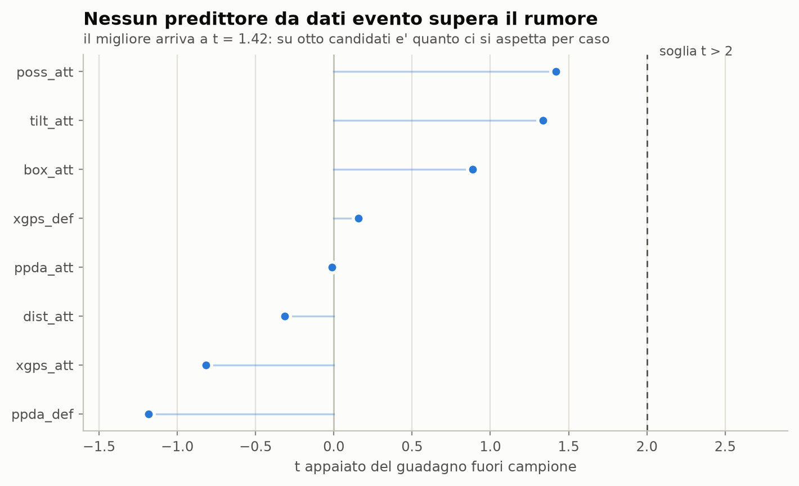
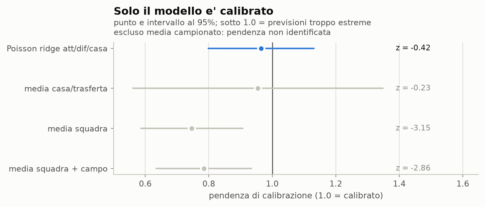
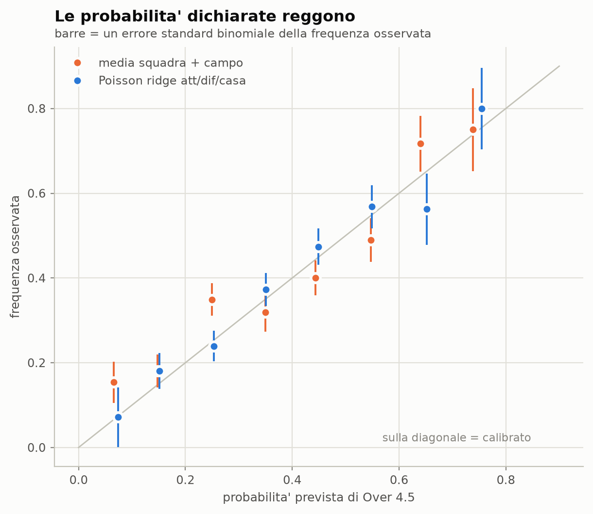
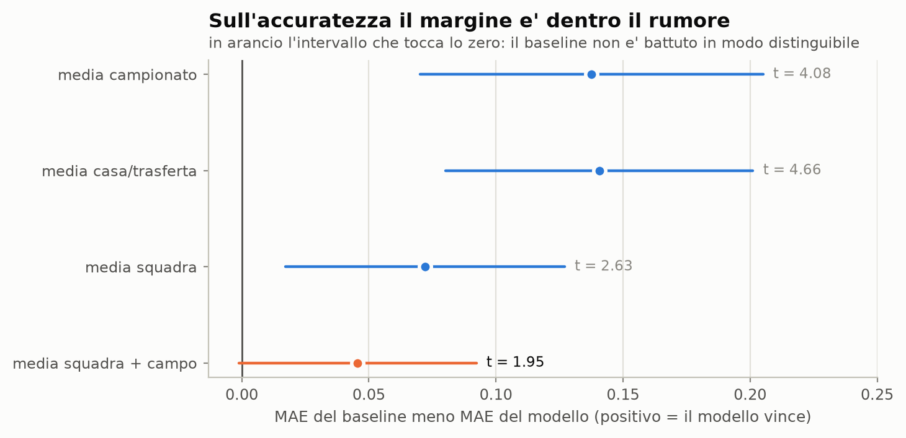
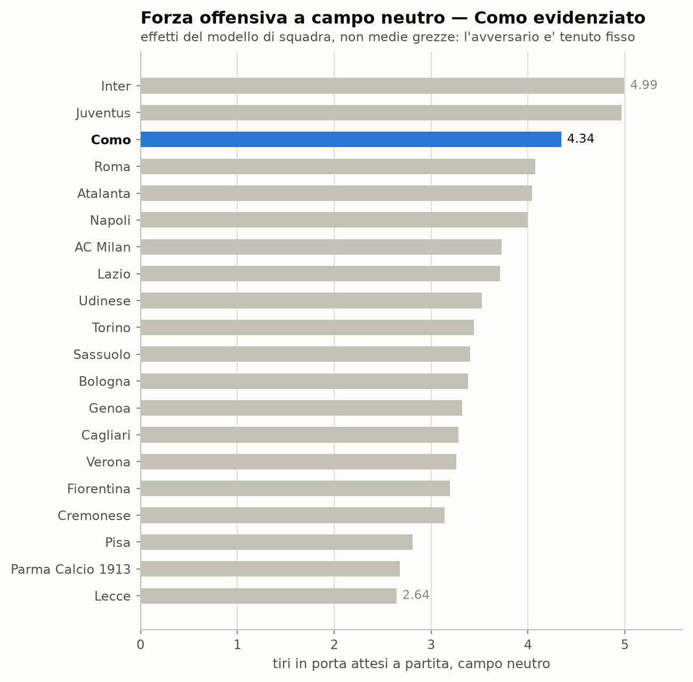
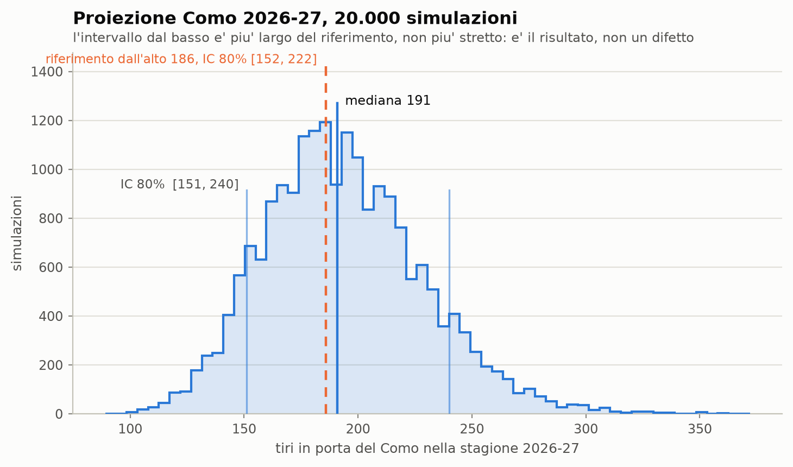
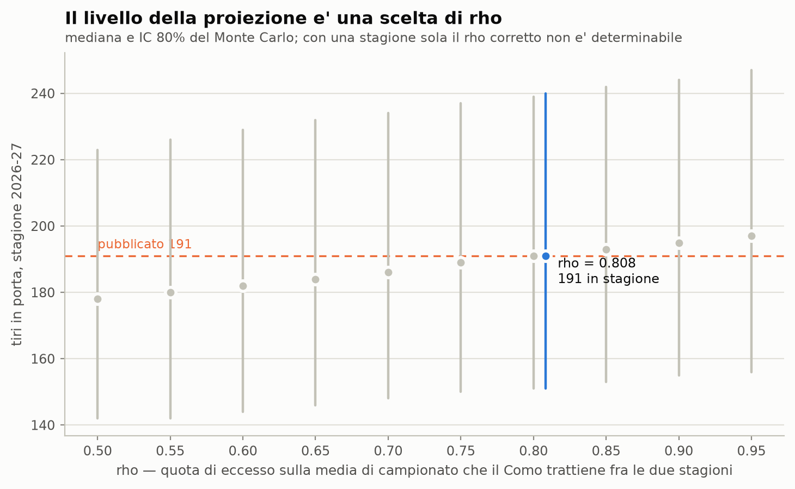
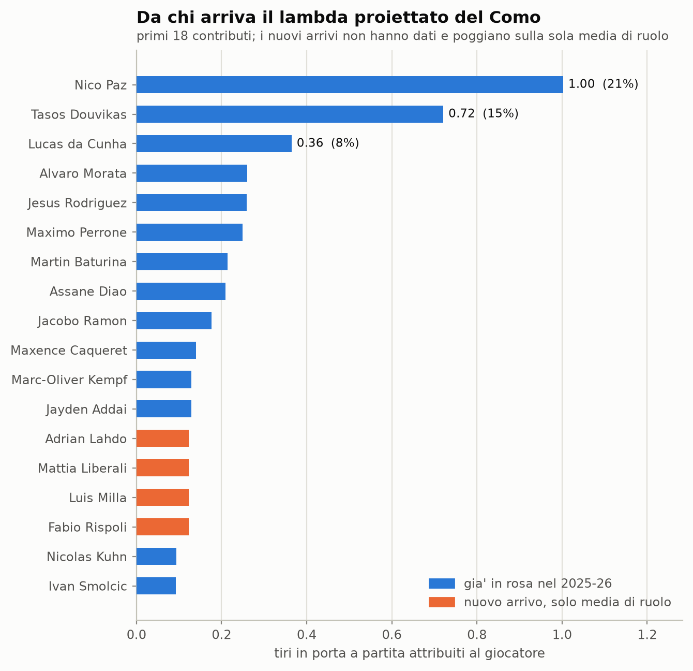

# Tiri in porta in Serie A — modello e proiezione

Modello dei **tiri in porta per squadra-partita** in Serie A 2025-26, costruito
dai dati evento WhoScored/Opta, e proiezione 2026-27 per il **Como** ricostruita
dai contributi dei singoli giocatori.

**L'esito in una frase: il modello si giustifica per la calibrazione, non per
l'accuratezza.** Sull'errore medio batte il baseline migliore per t = 1.95,
cioè dentro il rumore. Sulla pendenza di calibrazione la differenza è netta,
ed è quella la ragione per usarlo. Otto predittori da dati evento — possesso,
field tilt, PPDA, xG per tiro — sono stati **tutti scartati**: nessuno supera
il rumore fuori campione. Anche la scomposizione per giocatore, che è il punto
d'arrivo del progetto, **non batte** il tasso di squadra quando le si fa
decidere il livello — e nella versione che invece pubblichiamo, dove il livello
resta dall'alto, **non è mai stata validata**: il test disponibile non ha la
potenza per farlo.

Questi risultati negativi sono il contenuto del lavoro, non un intoppo.

---

## Riprodurre tutto da zero

```bash
python -m venv .venv
./.venv/Scripts/python.exe -m pip install -r requirements.txt   # Windows
./.venv/bin/python        -m pip install -r requirements.txt    # Unix

./.venv/Scripts/python.exe -m pytest tests/ -q       # 160 test, ~12 s
./.venv/Scripts/python.exe scripts/run_phase1.py     # tabelle + audit dei dati
./.venv/Scripts/python.exe scripts/run_phase2.py     # modello + predittori (~5 min)
./.venv/Scripts/python.exe scripts/run_phase3.py     # proiezione + Monte Carlo
./.venv/Scripts/python.exe scripts/run_phase4.py     # validazione consolidata
./.venv/Scripts/python.exe scripts/run_phase5.py     # figure 1-7 + output finale
./.venv/Scripts/python.exe scripts/run_phase6a.py    # la catena del livello
./.venv/Scripts/python.exe scripts/run_phase6b.py    # i due estimatori, separati
./.venv/Scripts/python.exe scripts/run_phase6c.py    # sensibilita' a rho + figura 8
./.venv/Scripts/python.exe scripts/run_phase6d.py    # predittori a bassa informazione (~5 min)
./.venv/Scripts/python.exe scripts/run_phase6e.py    # calendario e insieme degli avversari
```

`run_phase5.py` **ridisegna le figure 1-7 di questo README da zero** (la
figura 8 è di `run_phase6c.py`) e riscrive l'output della proiezione. Nessun numero qui sotto è digitato a mano:
ognuno viene da `data/processed/` o dai CSV che le fasi precedenti scrivono in
`reports/`.

I dati grezzi (380 CSV per-partita, ~1 GB) non sono nel repository; si
rigenerano con lo scraper (vedi in fondo).

---

## Che cos'è un tiro in porta, qui

Una sola definizione in tutto il repository, in [`sot/shots.py`](sot/shots.py):

```
isShot AND ( (type=='SavedShot' AND NOT shotBlocked) OR (type=='Goal' AND NOT isOwnGoal) )
```

Esclude i tiri fuori, i **pali** e i **tiri respinti da un difensore**.
WhoScored usa `SavedShot` sia per le parate sia per i blocchi: `shotBlocked` è
il discriminante. Coincide esattamente con il flag Opta `shotOnTarget`
(3066 = 3066 eventi).

Le quattro definizioni candidate sono state calcolate **in parallelo**, non
provate una dopo l'altra finché una combaciava con il riferimento. Includendo i
pali si otterrebbe 4.27 invece di 4.03.

**Controllo di sanità, superato senza alcun aggiustamento** (scarto massimo
+0.19%, soglia 5%):

| | riferimento | ottenuto |
|---|---|---|
| media di campionato | 4.03 | **4.034** |
| casa / trasferta | 4.43 / 3.63 | **4.432 / 3.637** |
| Como | 5.11 | **5.105** |
| partite | 380 | **380** |

---

## I dati

380 partite, 562.672 eventi, 20 squadre, dal 2025-08-23 al 2026-05-24.
Coordinate Opta 0-100, tutte le squadre attaccano verso x = 100.

| tabella | righe | |
|---|---|---|
| `team_match.parquet` | 760 | 24 colonne |
| `player_match.parquet` | 17.774 | 17 colonne |
| `shots.parquet` | 9.359 | tiri con geometria e xG |

- **Riconciliazione giocatori → squadra esatta su 760/760** partite, tolleranza
  zero, per tiri in porta, tiri, gol e xG.
- **Minuti riconciliati esattamente su 760/760** contro
  `11 × durata − minuti persi per inferiorità numerica`.
- **Nei dati non c'è xG.** Quello che usiamo è stimato in casa
  ([`sot/xg.py`](sot/xg.py)), cross-fitted a 5 fold raggruppati per partita:
  log-loss 0.243 contro 0.317 del tasso base, AUC 0.811, somma 900.6 contro
  900 gol. Va sempre chiamato **xG interno**, mai xG del fornitore.

Le trappole dei dati grezzi — booleane che spariscono quando l'evento non
capita mai in quella partita, `id` duplicati che non sono duplicati, rigori non
marcati da `situation`, `role_code = 5` che significa "sostituto" e non una
posizione — sono documentate in [CLAUDE.md](CLAUDE.md#trappole-che-sono-gia-costate-tempo).

---

## Il modello

```
log(lambda_ij) = mu + attacco_i + difesa_j + gamma * casa
```

Poisson con penalizzazione **ridge su attacco e difesa**, pesi a decadimento
esponenziale (emivita 150 giorni), `alpha` scelto in walk-forward.

La ridge non è solo regolarizzazione: senza penalità i due blocchi di dummy non
sono identificabili separatamente da `mu`. E, come si vede sotto, è anche la
ragione per cui il modello è l'unico candidato calibrato.

**Tutto è walk-forward.** Per prevedere una partita si usano solo partite con
data **strettamente antecedente**: vale per i parametri, per `alpha`, per le
medie mobili dei predittori, per i baseline, e — dalla Fase 4 — anche per la
dispersione `r` e per il tasso base con cui si misura il Brier.
[`tests/test_leakage.py`](tests/test_leakage.py) lo verifica meccanicamente
invece di affidarsi alla lettura del codice.

Split **per data**, non per giornata: i recuperi disallineano le giornate
ufficiali e userebbero, per una squadra, partite non ancora giocate.

---

## Predittori: tenuti e scartati

**Tenuti: nessuno.** Tutti e otto i candidati da dati evento sono stati
scartati.



| predittore | cos'è | `d_oos` | `t` | esito |
|---|---|---|---|---|
| `poss_att` | possesso della squadra | +3.82 | +1.42 | scartato |
| `tilt_att` | field tilt della squadra | +3.44 | +1.34 | scartato |
| `box_att` | tocchi in area | +1.86 | +0.89 | scartato |
| `xgps_def` | xG per tiro concesso dall'avversario | +0.10 | +0.16 | scartato |
| `ppda_att` | PPDA della squadra | −0.01 | −0.01 | scartato |
| `dist_att` | distanza media di tiro | −0.20 | −0.31 | scartato |
| `xgps_att` | **xG per tiro della squadra** | −1.08 | −0.82 | scartato |
| `ppda_def` | PPDA dell'avversario | −1.04 | −1.18 | scartato |

`d_oos` = guadagno di log-verosimiglianza **fuori campione**; `t` = statistica
appaiata sullo stesso guadagno; soglia dichiarata in anticipo, `t > 2`.

**Perché nessuno passa.** Il migliore arriva a t = 1.42, e su otto candidati un
massimo del genere è quanto ci si aspetta sotto l'ipotesi nulla (il massimo
atteso di otto statistiche nulle vale 1.4236). Gli effetti attacco/difesa con
decadimento assorbono già tutto quello che una media mobile di squadra può
portare: il predittore non aggiunge informazione, la ripete.

Quest'ultima frase non è più solo un'inferenza dal risultato fuori campione: si
vede nei due termini di ciò che il modello minimizza. Aggiungendo `poss_att`
sulle 660 righe in campione, la **penalità ridge scende da 10.54 a 5.91** e la
verosimiglianza grezza *peggiora*. Il predittore compra una riduzione della
penalità sostituendosi all'effetto attacco, non un adattamento migliore.

Nota su `xg_per_shot`, che era il candidato più promettente — l'idea
"qualità contro volume": **peggiora** la previsione (−1.08). Non va
reintrodotto senza nuove prove.

### E dove l'effetto attacco è ancora acerbo?

I numeri sopra misurano il valore **incrementale** contro un effetto attacco
con trenta giornate di storia. L'ipotesi opposta — che i predittori paghino
proprio dove quell'effetto è debolmente identificato — è stata testata a parte,
sulle **prime 8 partite di ciascuna squadra**, con gli stessi predittori, la
stessa soglia e la stessa correzione per la molteplicità
([`reports/phase6_predittori.md`](reports/phase6_predittori.md)). I risultati
stanno **accanto** a quelli sopra, non al loro posto:

| regime | righe | `t` massimo | tenuti | potenza¹ |
|---|---|---|---|---|
| maturo (dalla 6ª in poi) | 660 | +1.42 | nessuno | 28% |
| acerbo (partite 1-8, valutabili 4-8) | 100 | +0.88 | nessuno | **11%** |
| solo le righe escluse dal burn-in (4-5) | 40 | +1.45 | nessuno | 19% |

¹ potenza contro l'effetto per riga più grande che gli otto candidati abbiano
mai prodotto su questi dati (`poss_att` nel regime maturo, +0.00579 di
log-verosimiglianza per riga). Il pavimento di un test a una coda con soglia
2.0 è 2.3%.

**Il `t` acerbo, da solo, non dimostra niente**: con l'11% di potenza un
non-rifiuto era il risultato più probabile anche se il predittore funzionasse.
Ciò che estende il risultato negativo al regime acerbo è il test **in
campione** sulle stesse righe — coefficienti stimati guardando proprio quelle
partite, il massimo favore possibile: il minimo `p` è 0.093, che sugli otto
candidati diventa 0.54. Non esiste un test più sensibile da provare dentro
questa specificazione. È un test **in campione**: un suo rifiuto non avrebbe
dimostrato valore predittivo, vale solo come limite superiore — ed è
approssimato, perché con la penalità ridge in mezzo un rapporto di
verosimiglianza non è esattamente un chi-quadro a un grado di libertà.

La premessa del blocco regge — nelle prime giornate c'è meno informazione di
squadra: per riga il modello stacca `media campionato` di +0.0395 nell'acerbo
contro +0.1047 nel maturo, e sulle sole partite 4-5 è **−0.0737**, cioè peggio
di un numero unico per tutti. Lo spazio per un predittore che aggiunga qualcosa
è lì, se è da qualche parte. Nessuno dei candidati lo occupa.

Ricaduta sulla lettura del risultato maturo: anche quel test aveva **28%** di
potenza contro il migliore dei propri effetti. Il "nessuno passa" resta
corretto, ma la sua forza viene dal fatto che gli effetti misurati erano
piccoli, non dal fatto che il test fosse sensibile.

---

## Validazione

660 righe valutate su 760 (burn-in: dalla 6ª partita di ciascuna squadra).
Modello e baseline sono valutati sulle **stesse** righe.

### 1. La calibrazione — il risultato principale



| modello | pendenza | errore standard | z vs 1.0 | compatibile con 1.0 |
|---|---|---|---|---|
| **Poisson ridge att/dif/casa** | **0.965** | 0.083 | **−0.42** | **sì** |
| media casa/trasferta | 0.955 | 0.197 | −0.23 | sì |
| media squadra + campo | 0.785 | 0.075 | **−2.86** | **no** |
| media squadra | 0.747 | 0.080 | **−3.15** | **no** |
| media campionato | non identificata | 1.565 | — | — |

Una pendenza sotto 1.0 significa **previsioni troppo estreme**. I due baseline
informativi lo sono di tre e quasi tre errori standard: una media campionaria
non regredisce verso il centro e prende per buono il rumore di poche partite.
La ridge corregge esattamente questo. È la giustificazione empirica più netta
del modello.

`media campionato` è esclusa dalla figura e non ha un `z` in tabella perché il
suo `log(lambda)` è quasi costante (sharpness 0.05): la pendenza è stimata su
nessuna variazione e non significa niente. Tenerla dilaterebbe l'asse di un
fattore cinque.

### 2. Le probabilità dichiarate



| modello | n | MAE | RMSE | bias | corr | sharpness | Brier | tasso base | ECE |
|---|---|---|---|---|---|---|---|---|---|
| **Poisson ridge att/dif/casa** | 660 | **1.7395** | 2.1525 | +0.0341 | **0.3944** | 0.959 | **0.2129** | 0.2390 | 0.0249 |
| media squadra + campo | 660 | 1.7851 | 2.1924 | +0.0352 | 0.3621 | 1.049 | 0.2193 | 0.2390 | 0.0563 |
| media squadra | 660 | 1.8116 | 2.2325 | +0.0352 | 0.3187 | 0.983 | 0.2225 | 0.2390 | 0.0502 |
| media casa/trasferta | 660 | 1.8802 | 2.3114 | +0.0361 | 0.1618 | 0.401 | 0.2352 | 0.2390 | 0.0096 |
| media campionato | 660 | 1.8771 | 2.3446 | +0.0361 | −0.0393 | 0.050 | 0.2380 | 0.2390 | 0.0142 |

Il Brier è sull'Over 4.5. Il **tasso base va letto sempre accanto**: da solo,
"Brier 0.213" non dice nulla. Anche `sharpness` (deviazione standard dei lambda
previsti) va letta insieme alla calibrazione — prevedere la media a tutti dà
calibrazione perfetta e sharpness zero, cioè nessuna informazione.

Scomposizione di Murphy (Brier = affidabilità − risoluzione + incertezza):

| modello | affidabilità ↓ | risoluzione ↑ | incertezza |
|---|---|---|---|
| **Poisson ridge att/dif/casa** | **0.00088** | **0.02444** | 0.23743 |
| media squadra + campo | 0.00386 | 0.02283 | 0.23743 |
| media squadra | 0.00362 | 0.01765 | 0.23743 |
| media casa/trasferta | 0.00066 | 0.00362 | 0.23743 |
| media campionato | 0.00075 | 0.00054 | 0.23743 |

Il Brier del modello è migliore anche su Over 2.5, 3.5 e 5.5, con margine dello
stesso ordine ovunque: il vantaggio non dipende dalla soglia scelta.

**Anche la forma della distribuzione regge, non solo la media.** PIT
randomizzato per conteggi: chi² = 6.03 su 9 gradi di libertà, p = 0.737. È un
controllo che la pendenza di calibrazione non fa — quella guarda solo il
livello di lambda. Copertura degli intervalli 62 / 87 / 98% sul nominale
50 / 80 / 95%: conservativa, com'è strutturale sui conteggi (gli estremi sono
interi).

**Sovradispersione**: r NB2 = 26.0, IC95% profilo [13.7, 111.8]. Il rapporto
varianza/media grezzo è 1.363, ma **condizionato a lambda** scende a 1.156: il
57% dell'eccesso è variazione sistematica che il modello spiega.

### 3. Contro i baseline



| confronto appaiato | Δ log-verosimiglianza | t | Δ MAE | t |
|---|---|---|---|---|
| vs media campionato | +55.47 | 5.24 | +0.1377 | 4.08 |
| vs media casa/trasferta | +45.64 | 4.62 | +0.1407 | 4.66 |
| vs media squadra | +24.45 | 2.85 | +0.0721 | 2.63 |
| vs media squadra + campo | +13.47 | **1.82** | +0.0456 | **1.95** |

Il modello vince su ogni metrica, ma il margine sul baseline migliore sta
**dentro le due deviazioni standard**. Quasi tutta la prevedibilità dei tiri in
porta è "questa squadra tira tanto, e gioca in casa".

### 4. Dove il modello è storto

Segmentazione per campo, terzile di lambda previsto e metà di stagione, con il
baseline affiancato in ogni segmento (tabelle complete in
`reports/phase4_validation.md`). Tre cose:

- **Il MAE cresce con lambda** (1.50 nel terzile basso, 2.01 nell'alto). È
  atteso: su conteggi la varianza cresce con la media. Va notato perché rende
  il MAE aggregato dominato dalle squadre che tirano di più.
- **Il bias è concentrato in trasferta** (+0.077 contro −0.009 in casa) — ma
  **anche per il baseline** (+0.082). È una proprietà dei dati, non del modello.
- **Il modello ha Brier migliore in 6 segmenti su 7.** Perde nel **terzile alto
  di lambda** (+0.0031). È lo stesso punto in cui fallisce la scomposizione per
  giocatore, e la causa è la stessa: la ridge è un ritorno alla media, e le
  squadre che tirano molto sono quelle che il ritorno alla media penalizza.

---

## Forza offensiva delle squadre



Tiri in porta attesi contro una difesa media — non la media grezza, che dipende
da chi hai incontrato. Tabella completa in `reports/phase5_ratings.csv`.

**Attenzione alla scala: quei numeri sono la trasferta, non il campo neutro.**
Il rating è `exp(mu + attacco + difesa media)` e `is_home` è una dummy 0/1,
quindi il termine di campo vale zero. Per il Como: **4.343 in trasferta,
5.287 in casa** (×1.217), **4.815 di media su 19 + 19**, che è la scala su cui
si leggono i tassi di stagione. La definizione non è stata cambiata — spostarla
al punto medio geometrico porterebbe 4.34 a 4.79, cioè più vicino al livello
usato nella proiezione, ed è esattamente il tipo di aggiustamento che questo
progetto vieta. Le tre scale per tutte le squadre sono in
[`reports/phase6_livello.md`](reports/phase6_livello.md) e nelle colonne
`casa` / `media_calendario` del CSV.

### La ridge comprime, e si può misurare quanto

Regredendo i venti rating sui tassi grezzi riportati sulla stessa scala di
campo: **pendenza 0.760 ± 0.018**, intercetta 0.831, R² 0.99. Un tiro in porta
di eccesso grezzo diventa 0.76 tiri di eccesso nel rating.

Non è un difetto da correggere, è cosa fa una ridge: **minimizza l'errore
predittivo, non stima livelli senza distorsione.** L'errore quadratico si
abbassa tirando tutti verso il centro, e chi sta in alto è chi paga. È lo stesso
fenomeno visto altre due volte da altre angolazioni — il terzile alto di lambda
qui sopra, e il danno concentrato sopra 4.5 tiri in porta nella proiezione per
giocatore. Tre misure diverse, stesso segno.

La conseguenza pratica: **un rating non è un livello.** Il Como fa 4.815 di
rating su calendario medio contro 5.105 realizzati; de-comprimendo con la
pendenza si arriva a 5.06. Quale dei tre sia il livello giusto per il 2026-27,
con una stagione sola, questi dati non lo dicono.

---

## Proiezione Como 2026-27



| | per partita | stagione (38) | IC 80% |
|---|---|---|---|
| **dal basso** (questo lavoro) | **5.03** | **191** | [151, 240] |
| dall'alto (riferimento) | 4.90 | 186 | [152, 222] |

Il contributo dei dati per giocatore è **compositivo**: il rapporto fra la rosa
2026-27 con i minuti proiettati e la rosa 2025-26 con i minuti reali, che vale
**+1.0%**. Il **livello** resta quello dall'alto — fissarlo dal basso lo
conterebbe due volte. Chi esce vale il 15% dei minuti ma solo il 9% dei tiri in
porta; tutti i tiratori restano.

### Da dove viene il 5.03, moltiplicazione per moltiplicazione

| passo | fattore | risultato | che cos'è |
|---|---|---|---|
| riferimento dall'alto | — | **4.900** | valore **fornito**, non calcolato qui |
| rapporto compositivo di rosa | ×1.0101 | 4.950 | stimato dai dati per giocatore |
| convessità del Monte Carlo | ×1.0155 | 5.026 | artefatto numerico della simulazione |
| stagione (38 partite) | ×38 | **191** | |

Il terzo passo è quello che mancava, ed è il motivo per cui 4.90 × 1.01 faceva
4.95 e non 5.03: le perturbazioni su tassi individuali (+2.3%) e nuovi arrivi
(+0.7%) stanno **dentro** una somma di esponenziali e ne alzano il centro,
quella sui minuti va nel verso opposto (−1.6%) perché ridistribuire minuti verso
la rosa allargata li toglie a chi tira di più. Con `sources=()` la simulazione
restituisce l'ancora esatta, 4.9497.

**Il livello non viene dal modello di squadra.** Dentro `monte_carlo` il
contesto di squadra compare a numeratore e a denominatore e si semplifica:
moltiplicandolo per 1.5 il numero pubblicato non cambia di un bit (verificato,
e un test lo blocca). Rating, `alpha`, attacco e difesa decidono **come** il
lambda si ripartisce fra i giocatori, non **quanto** vale. Il livello è 4.90 ×
rapporto × convessità, e basta.

E **4.90 è un valore fornito**, dichiarato in `config.py` come modello di
persistenza su 21 stagioni (coefficienti 0.591 e 0.247): quelle stagioni non
sono in questo repository e nessun modulo contiene quel calcolo. Non è
ricostruibile qui — e la stessa cosa vale per l'ampiezza dell'intervallo, che
esce dall'IC80% del riferimento e non da questi dati. Il rating del modello
(4.815 su calendario medio) e il livello usato (4.90) sono due numeri con due
origini diverse: il primo è compresso dalla ridge, il secondo de-comprime di
×1.109 contro il ×1.316 che la pendenza giustificherebbe. Il gap non è un errore
di nessuno dei due, è la distanza fra una stima costruita per minimizzare
l'errore sulla prossima partita e un livello di stagione.

Catena completa, inventario di ogni punto in cui il riferimento entra nei
calcoli e scomposizione del Monte Carlo fonte per fonte:
[`reports/phase6_livello.md`](reports/phase6_livello.md).

### Il livello è una scelta di ρ, e ρ non è stimabile qui



Il livello usato assume implicitamente che il Como trattenga una quota **ρ**
del proprio eccesso sulla media di campionato passando da una stagione
all'altra:

```
livello = media_lega + rho * (grezzo della squadra - media_lega)
        = 4.034      + rho * 1.071
```

Il valore implicito nel numero pubblicato è **ρ = 0.808** — ricavato dai numeri
della catena del livello, non ipotizzato: `livello_da_rho(0.808354)` restituisce
esattamente 4.90.

**Ogni 0.05 di ρ vale circa 2 tiri in porta di stagione** (2.09 sull'ancora,
2.15 sulla mediana simulata). Sull'intera griglia dichiarata 0.50–0.95 la
proiezione va da **178 a 197**: 19 tiri, cioè il 21% dell'ampiezza
dell'intervallo di credibilità [151, 240].

**Il ρ corretto non è determinabile senza altre stagioni.** `alpha` è scelto
per prevedere la partita t+1 e il test 1º/2º tempo è interno alla stagione:
entrambi misurano persistenza *dentro* la stagione, che è più alta per
costruzione — non sono stime di ρ e non vanno usate come tali. Griglia
completa, figura e discussione in
[`reports/phase6_rho.md`](reports/phase6_rho.md).

### Il calendario 2026-27 non è quello 2025-26

Tre promosse sostituiscono tre retrocesse, e delle promosse questi dati non
sanno niente. Prima di stimare: **quale insieme di avversari usa il codice?**
Nel repository ci sono entrambe le convenzioni — `ratings_per_campo` usa
l'avversario medio (è `fig5`), `como_context` usa l'insieme reale 2025-26 — ma
**nessuna delle due entra nel livello pubblicato**, perché il contesto di
squadra si semplifica. L'insieme di avversari entra per una terza via, che non
era mai stata scritta: ρ àncora il livello al **tasso grezzo del Como 2025-26**,
ottenuto contro l'insieme 2025-26. Il calendario 2026-27 non compare in nessun
punto del codice.

Ne segue che lo status quo non è "avversario medio": è **"le promosse difendono
come le retrocesse"**, sotto cui il fattore di calendario vale 1 esattamente. E
non è un'ipotesi neutra — Cremonese, Verona e Pisa hanno concesso 4.69 tiri in
porta a partita contro 4.03 di campionato: il trio che esce è già fra i più
battuti, quindi **il segno dell'effetto non è nemmeno determinato**.

| difesa assunta per ciascuna promossa | fattore | stagione |
|---|---|---|
| media di campionato (estremo: promosse forti come una squadra qualunque) | ×0.974 – ×0.981 | 186 – 188 |
| **come le retrocesse (quello che il codice assume oggi)** | **×1.000** | **191** |
| coorte promossa nel 2025-26 (riferimento empirico, **una coorte sola**) | ×1.007 – ×1.010 | 192 – 193 |
| peggiore difesa 2025-26 (estremo: tutte e tre porose come la più battuta) | ×1.011 – ×1.018 | 193 – 195 |

Ogni riga è un intervallo perché il calcolo è fatto su due scale affiancate: i
coefficienti di difesa del modello, che la ridge comprime e che quindi
**sottostimano** il ricambio, e i tiri concessi grezzi, che non sono compressi
ma sono più rumorosi. **L'intervallo dichiarato vale 9 tiri di stagione**, cioè
il 10% dell'ampiezza dell'intervallo di credibilità e 0.20 sulla scala di ρ,
contro i 0.45 della griglia di ρ: il calendario è la **più piccola** delle
assunzioni non stimabili del progetto.

**Nessuna correzione è stata applicata**, e non per prudenza: sarebbe un doppio
conteggio. 4.90 esce da un modello di persistenza su 21 stagioni, e in 21
stagioni ci sono 21 ricambi di neopromosse — quel livello contiene già un
calendario che cambia tre squadre l'anno. Dettaglio, classifica e scenari in
[`reports/phase6_calendario.md`](reports/phase6_calendario.md).



Nico Paz vale da solo il **21%** del lambda proiettato. Il suo grezzo 1.39
tiri in porta/90 diventa **0.98 in contesto neutro**: è la correzione di
contesto che rende il numero portabile fra club, e senza di essa si
sovrastimerebbe chiunque giochi in una squadra dominante.

Output completo con intervalli e scomposizione riga per riga:
[`reports/phase5_proiezione_como_2627.md`](reports/phase5_proiezione_como_2627.md)
e il CSV omonimo.

### L'intervallo è più largo del riferimento, non più stretto

Non è un difetto del calcolo: è il risultato. Lo shock di squadra **non è stato
ridotto** — la sua varianza assoluta è quella ereditata dal riferimento. Il
metodo per giocatore *sostituisce* lo 0.4% di incertezza sui coefficienti con
il 29.7% su minuti (18.1%), tassi individuali (10.2%) e nuovi arrivi (1.4%).

### Il metodo dal basso non si giustifica — ma quale metodo dal basso?

"Dal basso" erano **due stimatori diversi con un nome solo**, e il test li
riguarda in modo opposto. Da qui in poi hanno due nomi anche nel codice:

| | chi decide il **livello** | chi decide la ripartizione | dove sta |
|---|---|---|---|
| **A — livello dai giocatori** | i giocatori | i giocatori | `stima_livello_dai_giocatori` |
| **B — compositivo** | l'ancora dall'alto (4.90) | i giocatori, via rapporto di rosa | `stima_compositiva` |

**La proiezione pubblicata usa B. Il test bocciava A.**

**Test 1º/2º tempo di stagione** — stima sulle prime 19 partite di ogni
squadra, previsione delle 19 successive:

| metodo | MAE | RMSE | correlazione |
|---|---|---|---|
| nessun aggiustamento di rosa (= media squadra 1ª metà) | 0.416 | 0.561 | 0.839 |
| **A** — livello dai giocatori | 0.482 | 0.616 | 0.798 |
| **B** — compositivo (quello pubblicato) | 0.415 | 0.560 | 0.842 |
| baseline: media di campionato | 0.822 | 1.021 | non definita |

**Su A il risultato negativo resta**: differenza appaiata −0.067 a favore del
tasso di squadra (t = −1.33). Con 20 righe nulla è significativo, ma il segno è
contrario al metodo più complesso. E si noti cos'è "dall'alto": **letteralmente
il baseline "media squadra"**. L'estimatore A non batte il più banale baseline
di squadra che esista.

**Su B il test non dice niente, e va detto così.** Il baseline corretto per un
estimatore che non fissa il livello non è un altro livello: è **lo stesso
livello con rapporto ≡ 1.0**, cioè "nessun aggiustamento di rosa". La
differenza è +0.0004 di MAE (t = +0.03) — che **non è una conferma, è mancanza
di potenza**: l'effetto minimo rilevabile su 20 squadre vale 0.039 di MAE,
mentre l'aggiustamento compositivo sposta le previsioni di 0.041 in media. Solo
se ogni aggiustamento fosse perfetto e nel verso giusto il test potrebbe
vedere qualcosa.

La ragione è strutturale: **fra le due metà di una stessa stagione non c'è
ricambio di rosa vero**. Si libera in media il 3.9% dei minuti (0.02% per il
Como, che è la squadra della proiezione), contro il 16.9% che cambia fra
un'estate e l'altra. Dettaglio, tabelle per squadra e potenza in
[`reports/phase6_compositivo.md`](reports/phase6_compositivo.md).

**Causa del risultato su A: doppia compressione.** Lo shrinkage per giocatore verso la media di
ruolo si somma a quello già applicato dalla ridge di squadra. Pendenza della
regressione dal-basso su dall'alto **0.875**; correlazione fra livello della
squadra e compressione aggiuntiva **−0.466**. Squadre sopra 4.5 tiri in porta:
MAE 0.541 dall'alto contro 0.729 dal basso. Sotto 4.5: 0.348 contro 0.349,
identiche. **Il danno è tutto sulle squadre di vertice** — e il Como è il caso
peggiore di tutti e venti.

Nessuna correzione arbitraria è stata applicata per farlo tornare.

---

## Limiti dichiarati

- **Una stagione sola.** Ogni intervallo è condizionato a 2025-26. Niente qui
  dice come il modello si comporti *attraverso* stagioni, che è esattamente
  l'orizzonte della proiezione 2026-27.
- **Il livello della proiezione non è stimato da questi dati.** 4.90 è un
  valore fornito e non ricostruibile con questo codice; il modello di squadra
  contribuisce solo il rapporto compositivo (+1.0%). Se 4.90 fosse sbagliato,
  niente in questo repository se ne accorgerebbe.
- **Anche l'ampiezza dell'intervallo è ereditata**: le deviazioni standard
  dello shock di squadra (65%) e del livello di campionato (6%) escono
  dall'IC80% del riferimento, non da una stima. Con una stagione sola lo shock
  fra stagioni non è osservabile.
- **La versione compositiva del metodo per giocatore — quella effettivamente
  pubblicata — non è mai stata validata.** Il risultato negativo del test
  1º/2º tempo riguarda l'estimatore che fissa il livello dai giocatori. Sul
  compositivo il test non ha potenza (effetto minimo rilevabile 0.039 di MAE
  contro un intervento medio di 0.041) perché fra due metà della stessa
  stagione la rosa non cambia: serve almeno una seconda stagione, con un vero
  mercato in mezzo.
- **Il livello assume ρ = 0.808 di persistenza fra stagioni**, che con una
  stagione sola non è stimabile. Ogni 0.05 di ρ sposta la proiezione di circa
  2 tiri in porta di stagione; l'intervallo 0.50–0.95 la sposta di 19.
- **Un rating non è un livello**: la ridge comprime con pendenza 0.760 ± 0.018,
  quindi i rating di `fig5` sottostimano le squadre di vertice per costruzione.
- **Il calendario 2026-27 non è in nessun punto del codice.** Il livello è
  ancorato al tasso grezzo del Como 2025-26, cioè a un numero ottenuto contro
  l'insieme di avversari del 2025-26; le tre promosse non hanno un rating
  stimabile da questi dati. L'intervallo dichiarato sulla loro difesa sposta la
  proiezione fra **186 e 195** tiri di stagione (0.20 sulla scala di ρ), e il
  segno non è determinato perché il trio che retrocede è già fra i più battuti.
  Non è stato corretto: 4.90 viene da 21 stagioni, che contengono già 21
  ricambi di neopromosse.
- **La congestione infrasettimanale non è modellata**, e il segno atteso è
  **negativo**: la Champions oggi entra solo dai minuti (rotazione 5–25%),
  mentre l'effetto sul lambda di squadra a parità di undici schierato non c'è
  affatto. Non è stimabile da questi dati — il Como 2025-26 non giocava le
  coppe, quindi il campione non contiene una sola sua partita congestionata —
  quindi su questo asse la proiezione è **ottimistica**, di quanto non si sa.
- **Rosa 2026-27 provvisoria**: il mercato chiude il 1 settembre 2026.
- **6 nuovi arrivi di movimento senza alcun dato** — 18% dei minuti proiettati
  e 13% del lambda poggiano sulla sola media di ruolo, con varianza gonfiata.
- **La rotazione Champions è un'assunzione**, non una stima: il Como 2025-26
  non giocava le coppe. Fatta variare fra 5% e 25% nel Monte Carlo.
- **Il test dei predittori ha poca potenza in tutti e due i regimi**: 28% sulle
  660 righe mature e 11% sulle 100 acerbe, contro il più grande effetto che gli
  otto candidati abbiano mai prodotto. "Nessuno passa" resta il risultato, ma
  la sua forza viene dalla piccolezza degli effetti misurati, non dalla
  sensibilità del test; a estendere la conclusione al regime acerbo è il test
  in campione (p corretto 0.54), non il `t`.
- **660 righe, 20 squadre.** Le due righe della stessa partita non sono
  indipendenti: i gradi di libertà effettivi sono minori del nominale.
- **Nessun backtest su quote.** Servirebbero prezzi di mercato reali. Il codice
  che usava quote generate dal modello era circolare ed è archiviato in
  [`legacy/`](legacy/) con la spiegazione: **non va riusato.**

---

## Struttura

```
sot/          il pacchetto: definizione dei tiri, minuti, xG interno, feature,
              modello di squadra, baseline, walk-forward, validazione,
              dispersione, modello per giocatore, rosa e proiezione, figure,
              catena del livello e sensibilità a rho, potenza del test dei
              predittori, insieme degli avversari e calendario
scripts/      run_phase1..5.py e run_phase6a/b/c/d/e.py — ogni fase riscrive i
              propri report
tests/        160 test: dati, leakage, modello, proiezione, metriche, figure,
              catena del livello, i due estimatori, rho, potenza dei
              predittori, calendario
legacy/       backtest circolare archiviato (NON riusare)
reports/      output rigenerabili; solo le figure sono versionate
```

Codice e docstring sono in **italiano**. Ogni scelta non ovvia è spiegata nella
docstring del modulo con il *perché*, non solo il cosa.
[CLAUDE.md](CLAUDE.md) contiene il diario di progetto completo, fase per fase.

---

## Origine del repository

Nasce come fork di
[Scrape-Whoscored-Event-Data](https://github.com/Ali-Hasan-Khan/Scrape-Whoscored-Event-Data)
di Ali Hasan Khan, che resta la fonte dei dati: `main.py`,
`Scrape matches.py` e `scrape_serie_a_2025_2026.py` scaricano gli eventi dalla
chalkboard di [WhoScored](https://www.whoscored.com/) via Selenium e li
appiattiscono con `createEventsDF`. Il modello EPV nel repository originale è
di [Laurie Shaw](http://eightyfivepoints.blogspot.com/); le visualizzazioni
usano [mplsoccer](https://github.com/andrewRowlinson/mplsoccer).

Da lì in poi il progetto è di modellazione statistica e non ha più a che fare
con lo scraping, che serve solo a rigenerare i dati grezzi.
