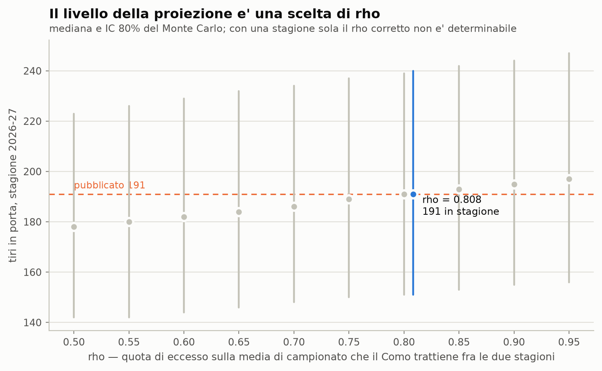

# Fase 6C — shrinkage entro stagione contro shrinkage fra stagioni

`alpha` e' scelto per prevedere la partita t+1 date le precedenti: e' shrinkage **entro** la stagione. La proiezione risponde a un'altra domanda — il 2026-27 dato il 2025-26 — e su quell'orizzonte la persistenza e' piu' bassa, quindi lo shrinkage corretto e' piu' forte. Anche il test 1o/2o tempo e' interno alla stagione e sovrastima la persistenza per costruzione. **Con una stagione sola il coefficiente giusto non e' stimabile, e qui non si prova a stimarlo.**

## Esito in breve

1. **La proiezione pubblicata assume rho = 0.808**, cioe' che il Como trattenga l'80.8% del proprio eccesso sulla media di campionato passando da una stagione all'altra. Non e' un'ipotesi fatta qui: e' ricavata dai numeri della Fase 6A, e `livello_da_rho(0.808354)` restituisce esattamente 4.9.
2. **Ogni 0.05 di rho vale circa 2.1 tiri in porta di stagione** (2.09 sull'ancora, 2.15 sulla mediana simulata, che e' un intero e quindi si muove a scalini). Sull'intera griglia dichiarata 0.50-0.95 la proiezione va da 178 a 197, cioe' 19 tiri in porta.
3. **Il valore corretto non e' determinabile con questi dati.** Serve piu' di una stagione: rho e' una persistenza fra stagioni e con una stagione sola non ha nemmeno un campione su cui essere calcolata. L'intera griglia sposta la proiezione di 19 tiri, contro un intervallo di credibilita' largo 89 ([151, 240]): 21% di quell'ampiezza. Non e' il termine dominante dell'incertezza, ma non e' trascurabile — e a differenza degli altri e' un'assunzione, non un rumore.

---

## 1. Che cos'e' `rho` e da dove viene il suo default

```
livello = media_lega + rho * (grezzo della squadra - media_lega)
```

E' la quota di eccesso sulla media di campionato che la squadra trattiene passando da una stagione all'altra. Sulla scala di calendario, dove vivono i tassi grezzi di stagione e il livello usato:

| grandezza | valore |
|---|---|
| media di campionato 2025-26 | 4.0342 |
| Como grezzo 2025-26 | 5.1053 |
| eccesso del Como | 1.0711 |
| livello usato nella proiezione | 4.9000 |
| eccesso del livello usato | 0.8658 |
| **rho implicito** | **0.8084** |

Il default **non e' stato scelto**: e' quello che il livello 4.90 gia' assumeva, letto dai numeri della sezione 4 di Fase 6A (eccesso usato 0.7809 contro eccesso grezzo 0.9661 sulla scala di trasferta, rapporto 0.8084). La grandezza e' invariante rispetto alla scala di campo, perche' le tre scale differiscono per lo stesso fattore moltiplicativo: calcolata sulla scala di calendario da' lo stesso numero, e un test lo verifica.

**Attenzione a non confonderlo con la compressione della ridge.** Sono due cose diverse che agiscono nella stessa direzione:

- la ridge comprime i rating **dentro** la stagione con pendenza 0.760: e' una proprieta' dello stimatore, misurata in campione (Fase 6A, sezione 4);
- `rho` = 0.808 e' un'assunzione sul **futuro**: quanto di quello che una squadra ha fatto si ripete l'anno dopo. Nessuno dei due e' stimato dall'altro.

---

## 2. La proiezione lungo la griglia di rho

Griglia dichiarata in anticipo (`level_chain.RHO_GRID`): 0.50-0.95 a passi di 0.05. Cambia **solo** l'ancora del livello: rapporto compositivo, Monte Carlo, seed e fonti di incertezza restano quelli pubblicati, 20000 simulazioni ciascuna.

|    rho |   livello_dall_alto |   per_partita |   stagione |   q10 |   q90 |
|-------:|--------------------:|--------------:|-----------:|------:|------:|
| 0.5    |              4.5697 |        4.6842 |        178 |   142 |   223 |
| 0.55   |              4.6233 |        4.7368 |        180 |   142 |   226 |
| 0.6    |              4.6768 |        4.7895 |        182 |   144 |   229 |
| 0.65   |              4.7304 |        4.8421 |        184 |   146 |   232 |
| 0.7    |              4.7839 |        4.8947 |        186 |   148 |   234 |
| 0.75   |              4.8375 |        4.9737 |        189 |   150 |   237 |
| 0.8    |              4.8911 |        5.0263 |        191 |   151 |   239 |
| 0.8084 |              4.9    |        5.0263 |        191 |   151 |   240 |
| 0.85   |              4.9446 |        5.0789 |        193 |   153 |   242 |
| 0.9    |              4.9982 |        5.1316 |        195 |   155 |   244 |
| 0.95   |              5.0517 |        5.1842 |        197 |   156 |   247 |



Pendenza sulla griglia: **43.0** tiri di stagione per unita' di rho, cioe' **2.15 per ogni 0.05** (R2 0.9984; i residui sono a scalini perche' la mediana simulata e' un intero). Sull'ancora, dove la relazione e' esattamente lineare, la pendenza vale 41.7 per unita' e 2.09 per 0.05.

---

## 3. Perche' non si prova a stimare rho

Con una stagione sola non esiste il campione su cui stimarlo. Le due quantita' che il progetto ha gia' misurato e che potrebbero sembrare candidate **non lo sono**:

- **`alpha` = 12.0** e' scelto in walk-forward per minimizzare l'errore sulla partita successiva. E' persistenza fra partite della stessa stagione, con la stessa rosa e lo stesso allenatore.
- **Il test 1o/2o tempo** (Fase 6B) misura la persistenza fra due meta' della stessa stagione: correlazione 0.839. E' un limite superiore per la persistenza fra stagioni, non una sua stima: fra due meta' di stagione non cambiano ne' la rosa ne' l'allenatore ne' la categoria.

Il riferimento fornito dichiara di venire da un modello di persistenza su 21 stagioni con coefficienti 0.591 sull'ultima stagione e 0.247 sulla penultima (`config.py`). Se fossero i coefficienti di un'autoregressione sui livelli, la loro somma (0.838) starebbe vicino al rho implicito qui ricavato (0.808). **Non e' una conferma**: quelle stagioni non sono nel repository, il calcolo non esiste in nessun modulo, e non e' nemmeno detto che i due coefficienti si applichino alla stessa parametrizzazione. Si segnala la vicinanza, non la si usa.

---

## Limiti di questo blocco

- **Rho non e' stimato, e' parametrizzato.** La griglia 0.50-0.95 e' un intervallo dichiarato, non un intervallo di confidenza: nessuno dei suoi estremi e' escluso da questi dati.
- **La sensibilita' e' solo sul livello.** L'ampiezza dell'intervallo resta quella ereditata dal riferimento (shock di squadra 65%, livello di campionato 6%): far variare rho sposta la proiezione, non la sua incertezza.
- **Rho e' definito sulla singola squadra.** Qui e' calcolato sul Como; una stessa rho applicata a tutte le squadre non e' testata, e la letteratura sul ritorno alla media suggerisce che dipenda dal livello — ma verificarlo richiede piu' stagioni.
- `tau` = 3, `alpha` = 12.0 e `r` = 26.0 sono quelli delle fasi precedenti, non ristimati qui.